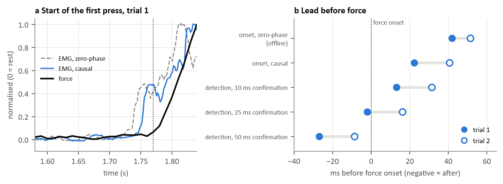

### Figure 1: sEMG comes before force (T1)

(a) Start of the first press in trial 1: aggregate activity of 251 HD-sEMG electrodes and the change in finger force from rest. Dotted line: force onset.
(b) Lead of the sEMG before force onset in both trials.

The activity is computed causally (band-pass filter and trailing 20 ms RMS window), as a real-time system would see it. An onset is the first point at which a signal stays above the rest noise threshold (rest mean + 5 standard deviations) for a confirmation time.

| | Trial 1 | Trial 2 |
|---|---|---|
| onset, zero-phase (offline) | 42 ms | 51 ms |
| onset, causal | 22 ms | 41 ms |
| detection, 10 ms confirmation | 13 ms | 32 ms |
| detection, 25 ms confirmation | −2 ms | 16 ms |
| detection, 50 ms confirmation | −27 ms | −9 ms |

The causal sEMG onset preceded force onset by 22 and 41 ms. A real-time detector can only declare the onset once the confirmation time has passed, so the lead it can use is shorter: with 10 ms of confirmation it fired 13 and 32 ms before force, and with 50 ms it fired after force had started. Shorter confirmation buys time at the cost of more false detections, which T7 measures. Zero-phase filtering with a centred window, common in offline analysis, uses samples after *t* and moves the onset earlier (42 and 51 ms).

Over RMS windows of 10 to 50 ms and thresholds of 3 to 8 SD, the causal onset lead in trial 1 stayed between 18.5 and 29.8 ms. Trial 2 was less stable: at some settings the activity dipped below threshold during the confirmation time, or a small burst before the press crossed it early. The full grid is in `results/hyser.json`.

These are two onsets from one person. In the random task the force of the five fingers rarely returns to rest, so each trial has one clean onset from rest. Acquisition, inference and actuation delays would shorten the usable lead further.
