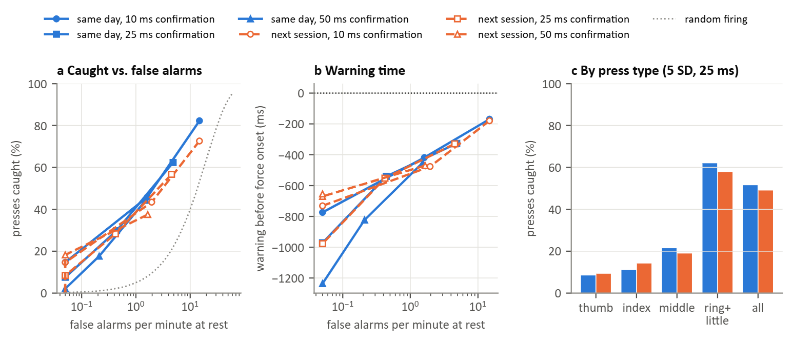

### Figure 10: Detecting the start of a press from sEMG (T1, T7, T8; putEMG-Force, 44 participants)

A causal detector watched the sEMG continuously. Each electrode's 20 ms log RMS was z-scored against its rest level in the calibration recording (`repeats_long`), and the detector followed the mean of the three most active electrodes. It fired when that value stayed above a threshold (3, 5 or 8 SD) for a confirmation time (10, 25 or 50 ms), and fired again only after 200 ms below threshold. It was tested on `sequential` and `repeats_short`: a median of 93 step presses per participant over both sessions.

- **Force onset:** the last time the force of the pressing finger(s) was at rest before it rose to half of the press (threshold: the larger of 5 SD of the rest noise and 2% of the press). Slow ramps and presses that did not start from rest were left out.
- **Caught:** the detector fired between 300 ms before force onset and the end of the press. Warning time: force onset minus the first firing (positive = before force).
- **False alarm:** a firing at rest, from 0.8 s after a press to 0.3 s before the next force onset.
- **Next session:** rest levels from session 1 applied to session 2, after the electrodes were placed again, without any update.

(a) Presses caught against false alarms per minute; the dotted line is what random firing at that rate would catch in the same windows. (b) Warning time. (c) Presses caught by press type at 5 SD and 25 ms.

Medians across participants (warning time: participants with at least 5 caught presses). In brackets: caught by random firing at the same false-alarm rate.

| Setting | Caught, same day | Caught before force onset | False alarms per min | Warning (ms) | Caught, next session | False alarms per min | Warning (ms) |
|---|---|---|---|---|---|---|---|
| 3 SD, 10 ms | 82% (52%) | 13% | 14.84 | −169 | 73% | 14.88 | −179 |
| 3 SD, 25 ms | 62% (22%) | 3% | 4.85 | −326 | 57% | 4.55 | −330 |
| 5 SD, 10 ms | 46% (8%) | 2% | 1.61 | −418 | 43% | 1.96 | −476 |
| 5 SD, 25 ms | 30% (2%) | 0% | 0.44 | −540 | 28% | 0.42 | −552 |
| 5 SD, 50 ms | 18% (1%) | 0% | 0.21 | −823 | 18% | 0.00 | −671 |
| 8 SD, 10 ms | 15% (0%) | 0% | 0.00 | −774 | 15% | 0.00 | −732 |

- At no setting did the detector fire before force onset for more than a small fraction of presses: 13% at the most sensitive setting, which also raised 15 false alarms per minute; at 5 SD and 25 ms, none. The median warning time was negative at every setting: the detector fired after force had started, 169 ms after at the most sensitive setting and 540 ms after at 5 SD and 25 ms.
- Fewer false alarms cost caught presses: from 82% caught at 15 false alarms per minute (random firing: 52%) to 30% at 0.44 per minute.
- Detection depended on the press type (5 SD, 25 ms, same day): ring and little fingers 62%, all fingers 52%, middle 21%, index 11%, thumb 8%.
- The next session gave similar numbers (28% caught at 0.42 false alarms per minute at 5 SD and 25 ms). False-alarm rates were almost unchanged, so the session-1 rest levels still described rest in session 2; the low catch rate was the same on both days.

The force sensor responds to small forces, so detecting a press before its force onset is a strict criterion. Even so, the low catch rates at thresholds that keep false alarms below one per minute indicate that the sEMG of these 24 forearm electrodes changed little at the start of single-finger presses at 20 to 50% of maximum force, relative to its fluctuations at rest. The thumb result likely reflects that part of the thumb's force comes from muscles in the hand, which the forearm bands do not cover. The positive delay of best prediction (Figure 9) therefore did not translate into early detection of press onsets with this electrode layout and detector.
