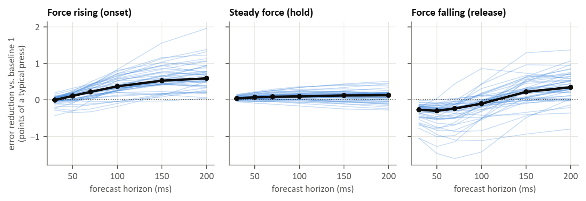

### Figure 11: Forecast against persistence (T2, putEMG-Force, 44 participants)

The analysis of Figure 7 on the putEMG-Force data: the force of each finger predicted 30 to 200 ms ahead, calibrated on `repeats_long` and tested on `sequential` and `repeats_short`, in both sessions. Errors are in points of each finger's typical press and pooled over the four fingers and both sessions. Each thin line is one participant; black is the median. Positive values mean the sEMG forecast had a lower error than baseline 1, which repeats the model's own current estimate.

Median gain against baseline 1, in points of a typical press. In brackets: participants with a clear gain / clear loss (their own 95% interval above / below zero), and the Wilcoxon signed-rank test across participants.

| Phase | 30 ms | 50 ms | 70 ms | 100 ms | 150 ms | 200 ms |
|---|---|---|---|---|---|---|
| Force rising | 0.0 (8/8, p = 0.970) | 0.1 (19/5, p = 0.002) | 0.2 (26/3, p < 0.001) | 0.4 (37/0, p < 0.001) | 0.5 (39/0, p < 0.001) | 0.6 (40/0, p < 0.001) |
| Steady force | 0.0 (30/2, p < 0.001) | 0.1 (32/3, p < 0.001) | 0.1 (32/3, p < 0.001) | 0.1 (31/3, p < 0.001) | 0.1 (27/4, p < 0.001) | 0.1 (25/6, p = 0.001) |
| Force falling | −0.3 (0/43, p < 0.001) | −0.3 (0/41, p < 0.001) | −0.2 (1/31, p < 0.001) | −0.1 (3/15, p = 0.009) | 0.2 (17/5, p < 0.001) | 0.3 (26/3, p < 0.001) |

- During force rise the gain was consistent but small: 0.4 points at 100 ms (clear in 37 of 44 participants, none with a clear loss) and 0.6 at 200 ms. In Hyser it was 1.4 and 3.7 points (Figure 7).
- During holds the gain stayed at 0.0 to 0.1 points.
- During release the forecast was worse than its own current estimate up to 100 ms (−0.3 points at 30 ms, a clear loss in 43 participants) and slightly better at 150 to 200 ms.
- The four fingers behaved alike during force rise (median gain at 100 ms: thumb 0.3, index 0.4, middle 0.4, ring+little 0.5).
- Repeating the measured force (baseline 2, needs a force sensor) beat the forecast by 6.0 points at 100 ms during force rise and by 25.7 to 33.1 points during holds. The two were similar at 200 ms during rise (p = 0.733), and the forecast was better at 150 to 200 ms during release.

The direction of the Hyser result held in a second dataset, with a smaller gain. The tasks differ (stepped presses to a visible target here, self-paced force changes in Hyser), so this comparison cannot separate the effect of the task from that of the recording setup. Within-participant intervals come from a moving-block bootstrap (500 resamples, 1 s blocks); the tests are not corrected for the 18 phase and horizon comparisons.
