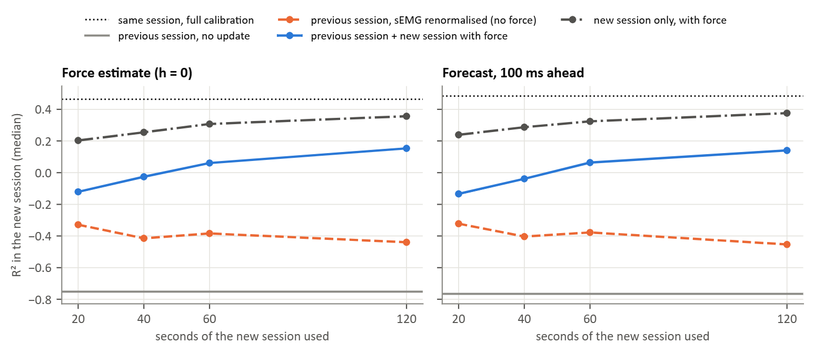

### Figure 12: Calibration from one session to the next (T8, T5; putEMG-Force, 43 participants)

The analysis of Figure 8 on the putEMG-Force data. The two sessions were 7 to 82 days apart (median 14), and the electrode bands were placed again. Test recording: session 2, `repeats_short`. Calibrations compared:

- **same session:** session 2, `repeats_long` and `sequential`, as the reference;
- **previous session, no update:** session 1, `repeats_long` and `sequential`;
- **previous session, sEMG renormalised:** the session-1 model with the sEMG normalisation updated on the first seconds of session 2 `sequential`, which needs no force;
- **previous session + new session with force:** session 1 plus the first seconds of session 2 `sequential`;
- **new session only:** the first seconds of session 2 `sequential`, which cycles through all five press types within its first 20 s.

Electrodes excluded in session 1 stay excluded. Score: R², mean over the four fingers. Participants: 43; for one participant a test recording is empty.

Median R² in the new session:

| Calibration | Force estimate (h = 0) | Forecast, 100 ms ahead |
|---|---|---|
| Same session, full calibration | 0.46 | 0.48 |
| Previous session, no update | −0.75 | −0.77 |
| Previous session, sEMG renormalised on 20 s | −0.33 | −0.32 |
| Previous session, sEMG renormalised on 120 s | −0.44 | −0.45 |
| Previous session + 20 s of the new session | −0.12 | −0.13 |
| Previous session + 40 s of the new session | −0.03 | −0.04 |
| Previous session + 60 s of the new session | 0.06 | 0.06 |
| Previous session + 120 s of the new session | 0.15 | 0.14 |
| New session only, 20 s | 0.20 | 0.24 |
| New session only, 40 s | 0.26 | 0.29 |
| New session only, 60 s | 0.31 | 0.32 |
| New session only, 120 s | 0.36 | 0.38 |

- A model calibrated in session 1 failed in session 2: R² −0.75, against 0.46 with a same-session calibration.
- Renormalising the sEMG without force did not repair it (−0.33 to −0.44).
- New-session data alone did best among the short calibrations: 0.20 with 20 s and 0.36 with 120 s, still below the full same-session calibration.
- Adding the session-1 data to the new data made the model worse at every length (−0.12 with 20 s, 0.15 with 120 s).

The failure of the old calibration replicates Figure 8, but the benefit of keeping old data does not: in Hyser, 25 s of day-1 data plus 10 to 20 s of day 2 matched or beat day 2 alone. A likely reason is the proportion. Here the session-1 calibration lasted about 11 min and outweighed 20 to 120 s of new data in a model that weights all samples equally; the dataset authors also note that band placement could differ slightly between sessions. A weighting that favours recent data might change this; it was not tested.
