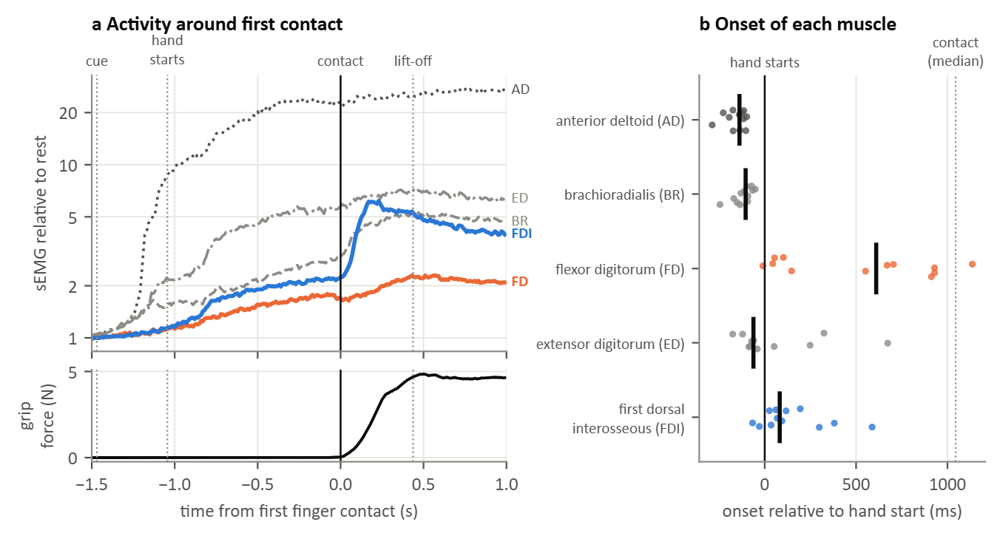

### Figure 13: Muscle onset relative to the movement and to finger contact (T1, WAY-EEG-GAL, 12 participants)

In WAY-EEG-GAL the pinch is part of a whole movement: after an LED cue the participant reaches for an object, grips it between thumb and index finger, lifts it, holds it, puts it back and returns the hand to rest (3,528 trials). sEMG was recorded from five muscles. In each trial, each muscle's causal 20 ms RMS was compared with its level with the hand at rest just before the cue, and the onset was the first time after the cue at which it stayed above 3 SD for 25 ms.

(a) sEMG relative to rest, aligned to the first finger contact (median over trials, then across participants), with grip force below.
(b) Onset of each muscle relative to the start of the hand movement; each point is one participant's median.

Median across participants (IQR in brackets):

| Muscle | Onset vs. hand start (ms) | Onset vs. first contact (ms) | Participants with onset after hand start | Trials with an onset |
|---|---|---|---|---|
| anterior deltoid (AD) | −138 (−179 to −115) | −1206 (−1394 to −921) | 0 of 12 | 99% |
| brachioradialis (BR) | −104 (−139 to −87) | −1164 (−1310 to −858) | 0 of 12 | 95% |
| flexor digitorum (FD) | 610 (90 to 916) | −474 (−612 to −321) | 11 of 12 | 75% |
| extensor digitorum (ED) | −62 (−80 to 101) | −1117 (−1210 to −795) | 4 of 12 | 99% |
| first dorsal interosseous (FDI) | 82 (33 to 221) | −820 (−912 to −739) | 10 of 12 | 100% |

The hand started moving 1044 ms before first contact (IQR 790 to 1168 ms), and lift-off followed contact by 437 ms.

- The shoulder and forearm muscles became active just before the hand moved (medians): anterior deltoid 138 ms, brachioradialis 104 ms and extensor digitorum 62 ms before.
- The first dorsal interosseous became active shortly after the hand started moving (82 ms; after hand start in 10 of 12 participants), about 820 ms before contact. During the reach it rose slowly, to about twice its rest level at contact (panel a).
- Its main burst came after contact: it was halfway to its peak 105 ms after contact (IQR 98 to 162 ms), against 225 ms (IQR 195 to 270 ms) for grip force; the sEMG came first in 11 of 12 participants.
- The flexor digitorum was the least modulated: an onset was found in 75% of trials (median), and its onset ranged between participants from the start of the reach to near contact (IQR 90 to 916 ms after hand start).

In this task the first dorsal interosseous carried a low-level signal from the start of the reach and its main increase only after contact, so finger-muscle activity before contact cannot be attributed to the pinch alone. The 20 ms trailing window delays the sEMG envelope by up to 20 ms. Event times are the authors', derived from the force and position sensors.
