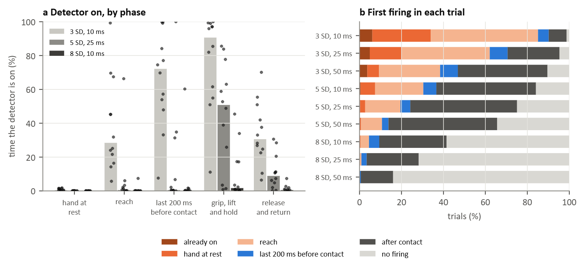

### Figure 14: Detector state during the movement (T7, T1, WAY-EEG-GAL, 12 participants)

The detector of Figure 10 applied to the two finger muscles recorded, the flexor digitorum and the first dorsal interosseous. Each muscle's causal 20 ms RMS is z-scored against its level with the hand at rest in series 1, and the detector follows the mean of the two. It fires when that value stays above *k* SD for a confirmation time and stays on until the value has been below *k* for 200 ms. Test: series 2 to 9. Time tested, all participants together: 257 min with the hand at rest, 41 min reaching, 10.5 min in the last 200 ms before contact, 194 min gripping, lifting and holding, and 67 min releasing and returning.

(a) Share of time the detector was on in each phase, for three settings: median across participants (bars) and each participant (points).
(b) Where the first firing of each trial fell, for all nine settings (mean of the participants' shares).

| Setting | On: reach | On: last 200 ms before contact | On: grip, lift and hold | False alarms per min at rest | First firing: before the reach | First firing: reach | First firing: last 200 ms before contact | First firing: after contact | No firing |
|---|---|---|---|---|---|---|---|---|---|
| 3 SD, 10 ms | 28% | 72% | 91% | 4.12 | 34% | 51% | 5% | 8% | 1% |
| 5 SD, 25 ms | 0% | 0% | 51% | 0.18 | 3% | 17% | 5% | 51% | 25% |
| 8 SD, 10 ms | 0% | 0% | 2% | 0.00 | 0% | 4% | 5% | 32% | 59% |

On-time is the median across participants; first firings are the mean of the participants' shares. "Before the reach" includes trials in which the detector was still on from the previous trial.

- At 3 SD and 10 ms the detector was on for 28% of the reach, and in 85% of trials it had already fired before the last 200 ms preceding contact (51% during the reach), with 4.12 false alarms per minute at rest (range 1.39 to 16.36).
- At 5 SD and 25 ms it was quiet at rest (0.18 false alarms per minute) and, in most participants, during the reach. It was also on for only 51% of the grip: the first firing came after contact in 51% of trials (median 113 ms after contact), and in 25% of trials it did not fire.
- At 8 SD it fired in fewer than half of the trials.
- At no setting did more than 8% of trials first fire in the last 200 ms before contact.
- Participants differed widely (points in panel a): at 5 SD and 25 ms, one participant's detector was on for most of the reach while others' stayed off for most of the grip.

With these two muscles, a fixed threshold did not separate the approach to a pinch from the reach: settings sensitive enough to fire before contact also fired during the reach and at rest, and settings that stayed quiet fired after contact or not at all. This is a rest-referenced baseline on two channels, not trained on reaches or grips; a trained detector or more electrodes may do better.
