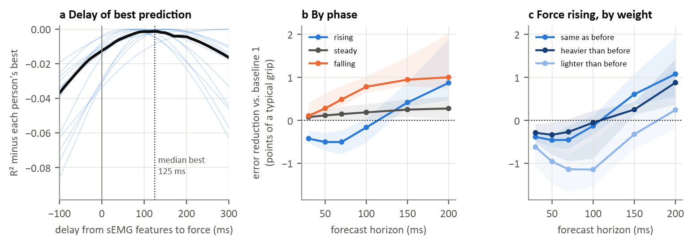

### Figure 15: Grip force: delay of best prediction and forecast gain (T1, T2, WAY-EEG-GAL, 12 participants)

The analyses of Figures 9 and 11 on grip force (mean normal force on the index and thumb plates), with the five muscles as input. Each of the nine series of a participant was tested with a model calibrated on the other eight. In the series where the contact surfaces were changed, the plates also record the experimenter handling the object between trials, so grip force was taken from 0.1 s before first contact to 0.2 s after release and set to zero elsewhere. Errors are in points of a typical grip (95th percentile of grip force). Positive values mean the sEMG forecast had a lower error than baseline 1, which repeats the model's own current estimate.

(a) R² relative to each participant's best delay; black: median.
(b) Gain against baseline 1 while grip force rises, holds or falls: median across participants, band between the 25th and 75th percentiles.
(c) The same while grip force rises, split by the object's weight relative to the previous trial.

Median gain against baseline 1, in points of a typical grip. In brackets: participants with a clear gain / clear loss (their own 95% interval above / below zero), and the Wilcoxon signed-rank test across participants.

| Phase | 30 ms | 50 ms | 70 ms | 100 ms | 150 ms | 200 ms |
|---|---|---|---|---|---|---|
| Force rising | −0.4 (1/10, p = 0.002) | −0.5 (1/10, p = 0.002) | −0.5 (1/9, p = 0.007) | −0.2 (1/5, p = 0.129) | 0.4 (9/0, p = 0.001) | 0.9 (11/0, p < 0.001) |
| Steady force | 0.1 (8/1, p = 0.010) | 0.1 (8/1, p = 0.010) | 0.1 (8/0, p = 0.013) | 0.2 (9/2, p = 0.012) | 0.2 (9/2, p = 0.019) | 0.3 (7/3, p = 0.017) |
| Force falling | 0.1 (7/1, p = 0.010) | 0.3 (10/0, p = 0.001) | 0.5 (12/0, p < 0.001) | 0.8 (12/0, p < 0.001) | 0.9 (12/0, p < 0.001) | 1.0 (12/0, p < 0.001) |
| Force rising, same weight | −0.4 (1/10, p = 0.002) | −0.5 (1/10, p = 0.003) | −0.5 (1/9, p = 0.007) | −0.1 (2/3, p = 0.331) | 0.6 (11/0, p = 0.001) | 1.1 (12/0, p < 0.001) |
| Force rising, heavier | −0.3 (1/7, p = 0.009) | −0.3 (1/6, p = 0.027) | −0.3 (1/5, p = 0.067) | −0.1 (1/3, p = 0.339) | 0.2 (2/0, p = 0.007) | 0.9 (6/0, p = 0.002) |
| Force rising, lighter | −0.6 (0/11, p < 0.001) | −1.0 (0/11, p < 0.001) | −1.1 (0/11, p < 0.001) | −1.1 (0/10, p < 0.001) | −0.3 (3/1, p = 0.622) | 0.2 (4/1, p = 0.266) |

- Grip force was predicted best at a positive delay in all 12 participants: median 125 ms (IQR 88 to 152 ms; Hyser 130 ms, putEMG-Force 100 ms). Looking ahead raised R² only from 0.65 to 0.66 (medians), because most of the signal is steady holding.
- During force rise the forecast was worse than its own current estimate at 30 to 70 ms (−0.4 to −0.5 points, a clear loss in 9 or 10 participants) and better at 150 ms (0.4) and 200 ms (0.9 points, a clear gain in 11 of 12).
- During release the gain grew with the horizon, to 0.8 points at 100 ms and 1.0 at 200 ms (a clear gain in all 12 participants from 70 ms). During holds it was 0.1 to 0.3 points.
- Repeating the measured force (baseline 2, needs a force sensor) beat the forecast up to 70 ms in every phase and at all horizons during holds (by 14.0 to 22.9 points). During force rise the forecast was better at 150 and 200 ms (10.7 and 14.9 points).
- When the object was heavier than in the previous trial, the gain did not differ clearly from trials with the same weight (differences −0.38 to 0.06 points, Wilcoxon p from 0.042 to 0.733). When it was lighter, the gain was lower at every horizon (by 0.25 to 1.00 points; lower in all 12 participants up to 100 ms, p < 0.001).

As in Hyser and putEMG-Force, forecasting added little beyond the model's own estimate: about one point of a typical grip at most, at 150 to 200 ms during force rise and from 70 ms during release. An unexpected weight change did not make the forecast more useful, and a lighter object made it less accurate. The weight cases rest on about 7 s of rising grip force per participant and case (median). Within-participant intervals come from a moving-block bootstrap (500 resamples, 1 s blocks); the tests are not corrected for the 36 phase, weight and horizon comparisons.
