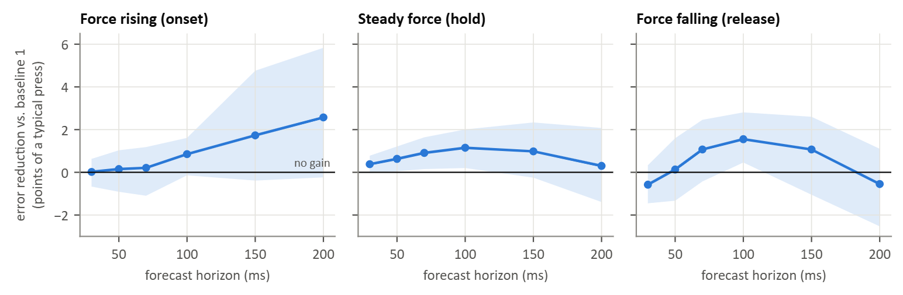

### Figure 2: Forecast against baselines (T2)

Middle finger force was predicted 30 to 200 ms ahead, calibrating on one trial and testing on the other in both directions. Errors are split into three phases: force rising (onset), steady force (hold) and force falling (release).

Each panel shows how much lower the EMG forecast's error was than that of baseline 1, which repeats the model's own current force estimate. That is the baseline a system without a force sensor can use. Positive values mean the forecast helps. Band: 95% interval from a moving-block bootstrap of the test samples (1 s blocks, the same resample for every model).

Error reduction against baseline 1, in points of a typical press [95% interval]:

| Horizon | Force rising | Steady force | Force falling |
|---|---|---|---|
| 30 ms | 0.0 [−0.7, 0.6] | 0.4 [−0.0, 0.8] | −0.6 [−1.4, 0.3] |
| 50 ms | 0.1 [−0.9, 1.0] | 0.6 [0.1, 1.2] | 0.1 [−1.3, 1.6] |
| 70 ms | 0.2 [−1.1, 1.2] | 0.9 [0.1, 1.6] | 1.1 [−0.4, 2.5] |
| 100 ms | 0.8 [−0.1, 1.6] | 1.1 [0.2, 2.0] | 1.6 [0.5, 2.8] |
| 150 ms | 1.7 [−0.4, 4.8] | 1.0 [−0.2, 2.3] | 1.1 [−1.1, 2.6] |
| 200 ms | 2.6 [−0.2, 5.8] | 0.3 [−1.4, 2.1] | −0.6 [−2.5, 1.1] |

- The gain over baseline 1 was small, at most 2.6 points. During force rise, the case that matters most for anticipation, the interval included zero at every horizon.
- The gains clearly above zero were during holds (50 to 100 ms) and release (100 ms), between 0.6 and 1.6 points.
- Baseline 2 repeats the last measured force, which needs a force sensor. It beat the forecast at 30 ms in every phase and up to 150 ms during holds, and lost from 100 ms ahead during force rise and release.
- The reduced physiological model (baseline 4) was worse than the EMG forecast at 150 and 200 ms during holds and at 100 to 200 ms during release, and similar elsewhere. Baseline 3 selected no trend and matched baseline 1.

Persistence of the measured force is very effective during holds, while sEMG may say more about upcoming changes, which is why the results are reported by phase. The intervals reflect variation over time within two recordings of one person, not between people. The full error table is printed in `hyser.ipynb` and saved in `results/hyser.json`.
