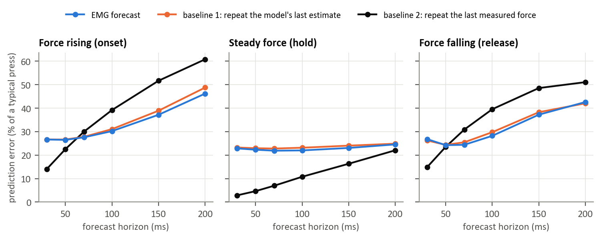

### Figure 2: Forecast against baselines (T2)

Prediction error, expressed as a percentage of a typical press, was compared across future force horizons and three phases: 
force rising (onset), steady force (hold) and force falling (release).

The plotted methods are the sEMG based forecast, baseline 1 (repeat the model's last estimated force) and baseline 2 (repeat the last measured force, 
available only as an offline laboratory reference).

The EMG forecast became better than baseline 2 during onset and release at horizons of around 70 ms and above.
It remained within approximately 2.6 percentage points of baseline 1.

Two additional references were evaluated but are not plotted as separate curves: 
baseline 3 selected no trend and thus matched baseline 1; baseline 4, 
the reduced physiological baseline, remained within approximately 2.5 percentage points of baseline 1 up to 100 ms.

The comparison shows why forecasting performance must be reported by phase. 
Persistence of actual measured force can be very effective during holds, 
while sEMG may be more informative about upcoming increases and decreases. 
A single average error could conceal this distinction.

This is a small, within participant, cross trial demonstration using middle finger force, 
Baseline 2 uses a measured force input that would not be available during normal deployment. 
