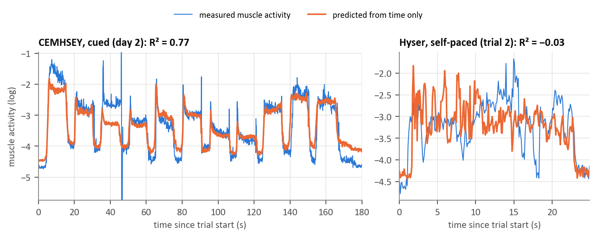

The predictor uses only elapsed time since the start of the trial, rather than the current sEMG. 
This checks whether a repeated experimental schedule is enough to predict a signal that appears to anticipate a movement.

In CEMHSEY, gesture timing follows a fixed cue protocol.
A trial from day 2 was predicted using the average activity pattern from four day 1 trials. 
The same general time only comparison was applied to Hyser's self paced contractions.

- CEMHSEY (cued): Time only prediction reached R² = 0.77 on the shown day 2 trial, with R² = 0.77–0.91 across six held-out trials.
- Hyser (self paced): Time only prediction reached R² = −0.03 in the shown direction and −0.18 in the reverse direction.

The result illustrates a potential confound: 
a highly regular experimental schedule can make activity appear predictable even without using current sEMG. 
Therefore, a force-forecasting model tested on cued data should be compared with a cue-only control and, where possible, assessed on less predictable trajectories.

CEMHSEY's GESTURE subset does not provide measured force; 
the predicted variable in this figure is muscle activity, not future pinch force. 
This is a protocol dependence stress test, not a force forecast validation.
