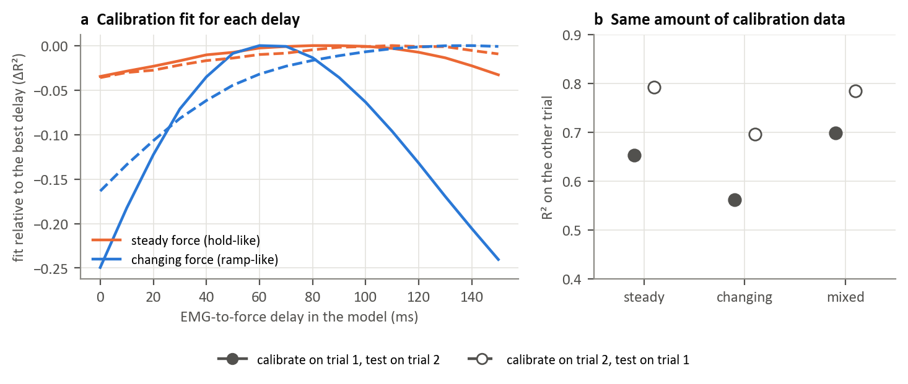

### Figure 3. Influence of calibration sample selection (T5)

Using Hyser middle-finger recordings from one participant, I compared three selections of labeled samples: steady force (including rest), changing force (rising and falling), and randomly selected mixed samples. Each selection contained the same number of samples within a trial (577 or 210 samples, depending on the trial).
Models were fitted on one trial and evaluated on the other, in both directions.

(a) The reduced physiological model showed greater sensitivity to the assumed EMG to force delay when fitted with changing force samples than with steady force samples. However, this variation in calibration fit does not establish that the true physiological delay has been identified.

(b) For forecasting force 50 ms ahead, steady force samples achieved R² values of 0.65 and 0.79, compared with 0.56 and 0.70 using changing force samples. Mixed samples achieved 0.70 and 0.78.

These exploratory results suggest that calibration sample selection affects both model fitting and subsequent prediction. 

Big limitation is that the samples were selected retrospectively from one participant's recordings. 
