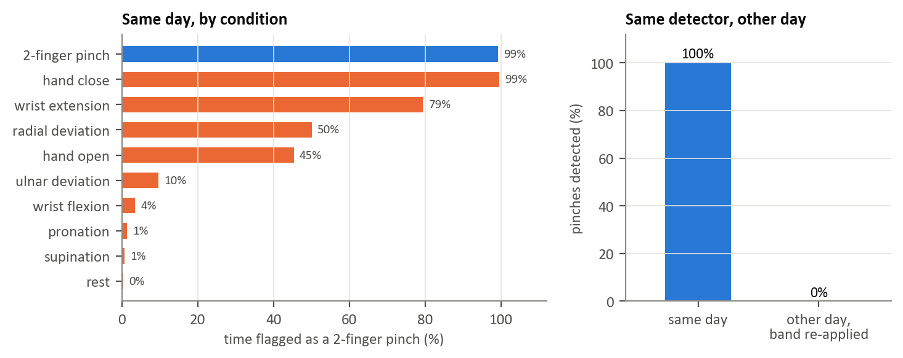

### Figure 5: False pinches and electrode reapplication (T7/T8)

A two-finger-pinch detector was fitted using pinch and rest examples, then evaluated on other movements and on recordings acquired after the electrode band was removed and re-applied on another day.

The left panel gives the percentage of time flagged as pinch during each labeled gesture condition. 
The right panel compares detected pinches on the same day and on the other recording day.

On the same day, the detector flagged:
- Two-finger pinch: approximately 99% of the time.
- Rest: approximately 0.4% of the time (0.3 false alerts/min in the reported resting analysis; the bar chart rounds this percentage to 0%).
- Hand close: 99% of the time.
- Wrist extension: 79% of the time.
- Radial deviation: 50% of the time.
The non pinch movement trials produced approximately 10 false-pinch events/min under the tested alert rule.

For the evaluated trials, the same detector detected 10 of 10 pinches on the calibration day, but 0 of 10 on the other day after the band was re-applied.
A detector can perform well on pinch and rest yet incorrectly trigger during ordinary hand or wrist actions. 
It may also fail after a change in electrode placement. 
False alarms should therefore be evaluated during movement, not just at rest, and the operating point should be checked across sessions.

Limitation: CEMHSEY GESTURE contains gesture/cue labels, not force-measured pinch onset. The percentages are the fraction of time the detector flagged a gesture as pinch;
The cross-day result comes from a small exploratory example
