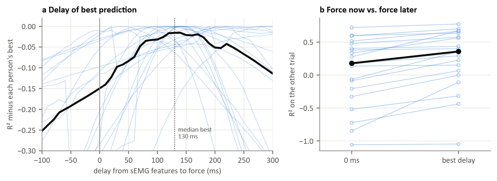

### Figure 6: How far ahead sEMG carries information about force (T1, 20 participants)

For each participant, ridge models were fitted from the causal sEMG features at time *t* (envelope now, 30 and 60 ms ago) to the middle finger force at *t* + *d*, for delays *d* from −100 to 300 ms. Each model was calibrated on one trial and scored on the other, in both directions. The delay with the highest R² shows how far ahead the sEMG carries most information about force. This uses whole recordings rather than single onsets, which in the random task are few and often do not start from rest.

(a) R² of each participant relative to their best delay; black: median.
(b) R² at 0 ms and at each participant's best delay.

- All 19 participants with an active middle finger predicted force best at a positive delay: median 130 ms, IQR 105 to 195 ms, range 20 to 300 ms. The pilot participant was at 70 ms.
- Looking ahead raised R² on the other trial from 0.18 at 0 ms to 0.36 at the best delay (medians).

This delay combines the electromechanical delay with the slow rise and fall of force, so it is longer than an onset latency. It sets the time scale at which a forecast can use the sEMG: from tens of milliseconds to about two hundred. For two participants the best delay was at the end of the tested range (280 and 300 ms).
