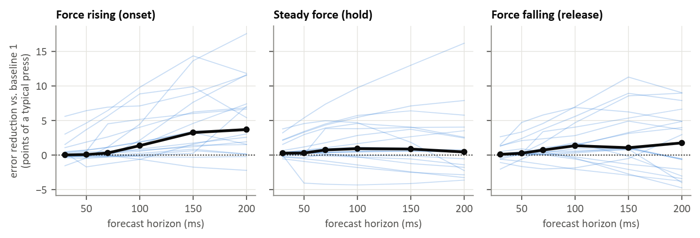

### Figure 7: Forecast against persistence across participants (T2, 20 participants)

The analysis of Figure 2 repeated for every participant: middle finger force predicted 30 to 200 ms ahead, calibrating on one trial and testing on the other in both directions. Each thin line is one participant (19 with an active middle finger); black is the median. Positive values mean the sEMG forecast had a lower error than baseline 1, which repeats the model's own current estimate.

Median gain against baseline 1, in points of a typical press. In brackets: participants with a clear gain / clear loss (their own 95% interval above / below zero), and the Wilcoxon signed-rank test across participants.

| Phase | 30 ms | 50 ms | 70 ms | 100 ms | 150 ms | 200 ms |
|---|---|---|---|---|---|---|
| Force rising | 0.0 (4/1, p = 0.157) | 0.1 (3/0, p = 0.153) | 0.3 (3/0, p = 0.023) | 1.4 (5/1, p = 0.001) | 3.3 (10/1, p < 0.001) | 3.7 (10/1, p < 0.001) |
| Steady force | 0.3 (7/1, p = 0.010) | 0.3 (9/3, p = 0.045) | 0.7 (10/3, p = 0.016) | 0.9 (10/3, p = 0.027) | 0.9 (8/2, p = 0.066) | 0.5 (5/2, p = 0.295) |
| Force falling | 0.1 (6/0, p = 0.349) | 0.3 (6/1, p = 0.033) | 0.7 (4/1, p = 0.004) | 1.4 (6/0, p = 0.015) | 1.1 (7/1, p = 0.030) | 1.8 (6/2, p = 0.182) |

- During force rise the gain grows with the horizon: about zero up to 70 ms, 1.4 points at 100 ms and 3.3 to 3.7 points at 150 to 200 ms, where it was clear for 10 of 19 participants.
- During holds and release the gains were smaller, mostly below 2 points.
- Repeating the measured force (baseline 2, needs a force sensor) beat the forecast up to 100 ms in every phase and at all horizons during holds. At 150 to 200 ms during rise and release the two were not different.
- The pilot participant was among the smaller gains: below 1 point at 100 ms during force rise, against a median of 1.4.

Within-participant intervals come from a moving-block bootstrap (500 resamples, 1 s blocks).
