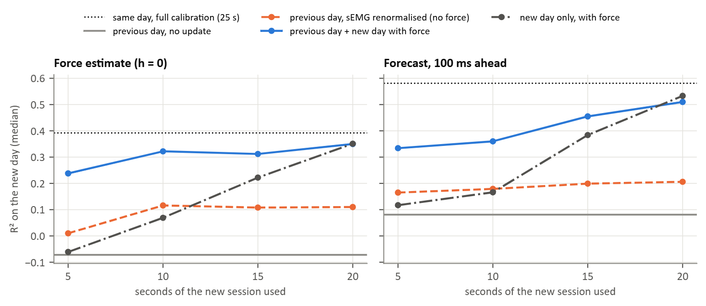

### Figure 8: Calibration from one day to the next (T8, T5; 20 participants)

The two Hyser sessions were recorded on separate days, so the electrodes were placed again. Test recording: session 2, trial 2, middle finger. Calibrations compared:

- **same day:** the whole of session 2, trial 1 (25 s), as the reference;
- **previous day, no update:** session 1, trial 1;
- **previous day, sEMG renormalised:** the session-1 model with the sEMG normalisation updated on the first seconds of session 2, trial 1, which needs no force;
- **previous day + new day with force:** session 1 plus the first seconds of session 2, trial 1;
- **new day only:** the first seconds of session 2, trial 1.

Electrodes excluded on day 1 stay excluded. Participants: 19 with an active middle finger in all four recordings.

Median R² on the new day:

| Calibration | Force estimate (h = 0) | Forecast, 100 ms ahead |
|---|---|---|
| Same day, 25 s | 0.39 | 0.58 |
| Previous day, no update | −0.07 | 0.08 |
| Previous day, sEMG renormalised on 10 s | 0.12 | 0.18 |
| Previous day + 10 s of the new day | 0.32 | 0.36 |
| Previous day + 20 s of the new day | 0.35 | 0.51 |
| New day only, 10 s | 0.07 | 0.17 |
| New day only, 20 s | 0.35 | 0.53 |

- A model calibrated on day 1 did not work on day 2.
- Updating the normalisation without force helped little.
- A short calibration with force on the new day recovered most of the performance, and keeping the day-1 data mattered when the new data were short (10 s or less).

For a device, this points to a short daily calibration of 10 to 20 s that adds to the earlier ones rather than replacing them. Each recording lasts 25 s, so longer calibrations could not be tested.
