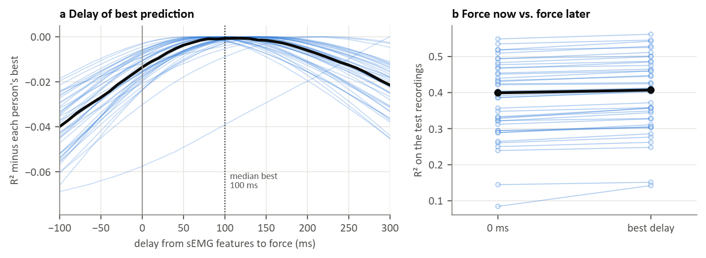

### Figure 9: How far ahead sEMG carries information about force (T1, putEMG-Force, 44 participants)

The analysis of Figure 6 on a second dataset. For each finger, ridge models were fitted from the causal sEMG features at time *t* to force at *t* + *d* (*d* from −100 to 300 ms), calibrated on `repeats_long` and scored on `sequential` and `repeats_short` of the same session. Each participant's profile is the mean over the four finger forces and the two sessions.

(a) R² of each participant relative to their best delay; black: median.
(b) R² at 0 ms and at each participant's best delay.

- All 44 participants predicted force best at a positive delay: median 100 ms, IQR 90 to 140 ms, range 50 to 300 ms. In Hyser (Figure 6) the median was 130 ms.
- Looking ahead changed R² little: 0.40 at 0 ms and 0.41 at the best delay (medians; difference 0.01, at most 0.06). In Hyser it rose from 0.18 to 0.36.
- R² differed between fingers (best R², median over participants): ring and little 0.67, middle 0.34, index 0.32, thumb 0.29.

The delay of best prediction replicated across the two datasets, but its effect on accuracy did not. This is likely because the putEMG presses are mostly steps held for 1 to 3 s: most of the force variance lies in the holds, where a shift of 100 ms changes little, whereas force in the Hyser random task changes continuously. As in Figure 6, this delay mixes the electromechanical delay with the dynamics of force and is not an onset latency. One participant had the best delay at the end of the range (300 ms) and the lowest R² (0.14).
