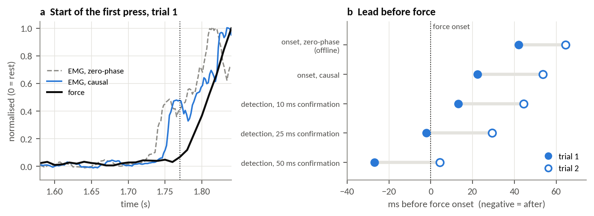

# Figure 1: sEMG before force, one person

Hyser subject 1, session 1. (a) Start of the first press from rest in trial 1: mean activity over the 251 electrodes that passed the check, and the change in force of the five fingers from rest. (b) How long before force onset the sEMG crossed threshold, in both trials.

Activity is computed causally (band-pass filter, trailing 20 ms RMS), so at time *t* it only uses samples up to *t*. An onset is the first time a signal stays above rest noise (mean + 5 SD) for a confirmation time. A detector can only declare the onset once that confirmation time has passed, so the lead it can use is shorter than the onset lead.

| Lead before force onset | Trial 1 | Trial 2 |
|---|---|---|
| sEMG onset, zero-phase (offline) | 42 ms | 65 ms |
| sEMG onset, causal | 22 ms | 54 ms |
| detection, 10 ms confirmation | 13 ms | 45 ms |
| detection, 25 ms confirmation | −2 ms | 29 ms |
| detection, 50 ms confirmation | −27 ms | 4 ms |

With 50 ms of confirmation the detector fired after force had started in trial 1. Zero-phase filtering, common offline, uses samples after *t* and moves the onset earlier. The notebook checks this: cutting the recording after *t* changes the zero-phase activity at *t* but not the causal one.

Changing the RMS window (10 to 50 ms) and the threshold (3 to 8 SD), the causal onset lead in trial 1 stayed between 18.5 and 29.8 ms. Trial 2 ranged from −146.5 to 61.1 ms, because at some settings a small burst before the press crossed threshold early, or the activity dipped below it during confirmation. The full grid is in `results/hyser.json`.

**How the force was recorded matters here.** Hyser stores force at 100 Hz, so onsets are resolved to 10 ms. The dataset description says force was low-pass filtered at 10 Hz (8th-order Butterworth) but not whether forward only or forward and backward. Forward only, it would delay force by about 80 ms (79 ms at 1 Hz, 82 ms at 3 Hz), which would make the sEMG lead look longer than it is. Forward and backward, there is no delay, but a step starts slightly early, which would make the lead look shorter. The stored force does not settle it: above 10 Hz its spectrum is flat, 32 to 38 dB below the 1 to 3 Hz band, instead of falling steeply as that filter would make it. So I report these leads as measured on the stored force and don't treat them as a physiological latency.

These are two onsets from one person: in the random task the five fingers rarely return to rest, so each trial has one clean onset. Acquisition, processing and actuation delays in a real system would shorten the usable lead further.
