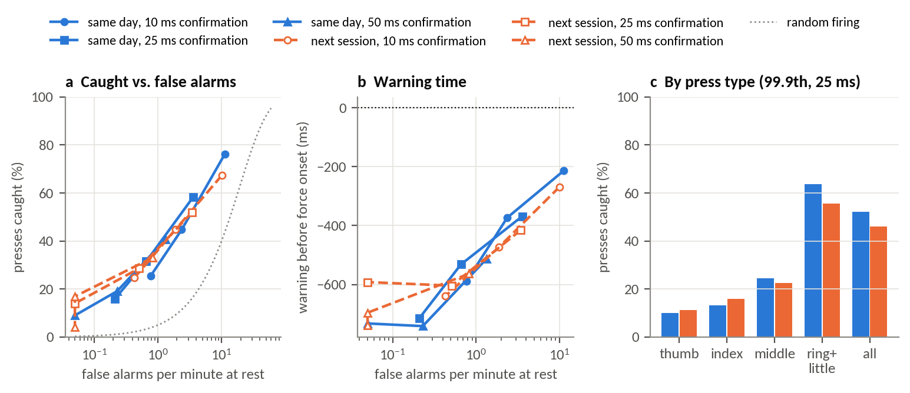

# Figure 10: Detecting the start of a press, putEMG-Force

A causal detector watching the sEMG continuously, 44 people.

**How it works.** Each electrode's 20 ms log RMS is z-scored against its rest level in the calibration recording (`repeats_long`). At each millisecond the detector output is the mean of the three highest z-scores, so the three electrodes can change from one moment to the next. The threshold is a percentile (99th, 99.9th or 99.99th) of that output during rest in the calibration recording; the 99.9th corresponded to a median of 4.8 SD. The detector fires when the output stays above threshold for a confirmation time (10, 25 or 50 ms), and can fire again only after 200 ms below it. It is tested on `sequential` and `repeats_short`.

**How it is scored.**

- *Force onset:* the last time the force of the pressing finger(s) was at rest before it rose to half of the press. Slow ramps, and presses that did not start from rest, are left out.
- *Caught:* the detector fired between 300 ms before force onset and the end of the press. *Warning:* force onset minus the first firing (positive means before force).
- *False alarm:* a firing at rest, from 0.8 s after a press to 0.3 s before the next force onset. Rest is defined from the force, so other movements that don't press the sensor are not tested.
- *Next session:* rest levels and thresholds from session 1, applied to session 2 without any update.

(a) Presses caught against false alarms per minute, one point per setting; the dotted line is what random firing at the same rate would catch in the same windows. (b) Warning time. (c) Presses caught by press type, at the 99.9th percentile and 25 ms.

Medians across people. In brackets, what random firing at the same rate would catch.

| Setting | Caught | Caught before force onset | False alarms per min | Warning | Caught, next session | False alarms, next session |
|---|---|---|---|---|---|---|
| 99th, 10 ms | 76% (44%) | 11% | 11.3 | −214 ms | 67% | 10.1 |
| 99th, 25 ms | 58% (16%) | 3% | 3.6 | −369 ms | 52% | 3.5 |
| 99.9th, 10 ms | 45% (11%) | 1% | 2.4 | −373 ms | 45% | 1.9 |
| 99.9th, 25 ms | 32% (3%) | 0.5% | 0.66 | −532 ms | 29% | 0.51 |
| 99.99th, 50 ms | 9% (0%) | 0% | 0 | −733 ms | 4% | 0 |

The detector almost never fired before force onset. At its most sensitive setting it did so for 11% of presses, with 11 false alarms per minute at rest, and the median warning was negative at every setting: it fired after force had started. Fewer false alarms cost caught presses, from 76% at 11 per minute to 32% at 0.66 per minute.

It depended a lot on the press (99.9th, 25 ms): ring and little fingers together 64%, all fingers 52%, middle 25%, index 13%, thumb 10%. Part of the thumb's force comes from muscles in the hand, which the forearm bands don't cover.

The next session looked much like the same day. False-alarm rates hardly changed, so the session-1 rest levels still described rest in session 2.

The force sensor responds to very small forces, so catching a press before its force onset is a strict test. Still, at settings with fewer than one false alarm per minute, the sEMG of these 24 electrodes changed little at the start of single-finger presses at 20 to 50% of maximum force, compared with its fluctuations at rest. This is a threshold on rest-referenced activity, not trained on presses, so it is a baseline for this electrode layout, not an upper bound.
