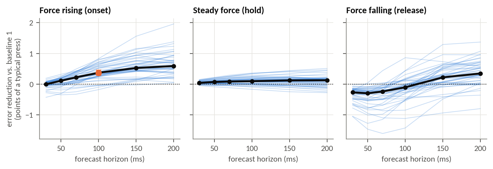

# Figure 11: Forecast against its own estimate, putEMG-Force

The analysis of [Figure 7](Figure7.md) on putEMG-Force: the force of each finger predicted 30 to 200 ms ahead, calibrated on `repeats_long` and tested on `sequential` and `repeats_short`, in both sessions. Errors are in points of each finger's typical press, pooled over the four fingers and both sessions. Thin lines are people, black is the median. Positive values mean the sEMG forecast had a lower error than baseline 1, its own current estimate.

**Primary comparison** (force rising, 100 ms ahead): median gain 0.37 points, 95% CI 0.29 to 0.46 from resampling people, Wilcoxon p = 2.5 × 10⁻⁸. Positive in 39 of 44 people, and clearly above zero within 37 of them.

Exploratory, median gain and in brackets the number of people whose own interval was above / below zero:

| Phase | 30 ms | 50 ms | 70 ms | 100 ms | 150 ms | 200 ms |
|---|---|---|---|---|---|---|
| Rising | −0.01 (9/8) | 0.11 (19/4) | 0.22 (26/3) | 0.37 (37/0) | 0.53 (39/0) | 0.59 (40/0) |
| Steady | 0.04 (31/2) | 0.07 (33/3) | 0.08 (32/3) | 0.10 (30/4) | 0.12 (29/4) | 0.12 (25/6) |
| Falling | −0.27 (0/43) | −0.30 (0/40) | −0.24 (1/31) | −0.11 (4/14) | 0.22 (17/5) | 0.34 (26/3) |

The gain went in the same direction as in Hyser and was much more consistent across people, but smaller: 0.4 points at 100 ms while force rose, against 1.4 in Hyser. During holds it stayed around 0.1. During release the forecast was worse than its own estimate up to 100 ms, clearly so in 43 people at 30 ms.

The four fingers behaved alike while force rose (median gain at 100 ms: thumb 0.33, index 0.36, middle 0.36, ring and little 0.49).

Repeating the measured force (baseline 2, needs a force sensor) was better by 6.0 points at 100 ms while force rose and by 26 to 33 points during holds. The forecast only caught up at 200 ms while force rose and from 150 ms during release.

The tasks differ (step presses to a visible target here, self-paced force changes in Hyser), so the size difference may come from the task as much as from the recording. Intervals within a person come from a moving-block bootstrap (500 resamples, 1 s blocks drawn within each test recording).
