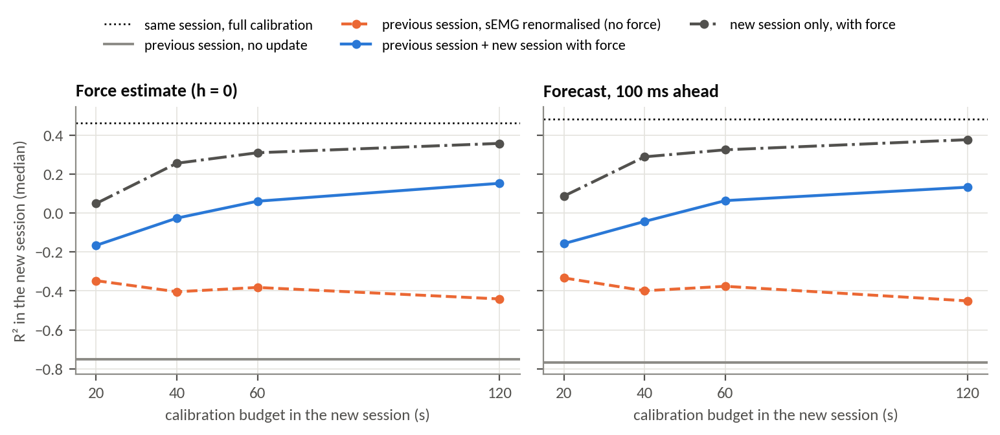

# Figure 12: From one session to the next, putEMG-Force

The analysis of [Figure 8](Figure8.md) on putEMG-Force. The two sessions were 7 to 82 days apart (median 14), with the electrode bands placed again. Test: session 2, `repeats_short`. Score: R², mean over the four fingers. 43 people with two sessions.

Calibrations: the same session (`repeats_long` and `sequential` of session 2, as the reference); session 1 as it is; session 1 with the sEMG normalisation updated on the start of session 2 `sequential` (no force needed); session 1 plus that start with force; or that start alone. `sequential` cycles through all five press types. Budgets count from the start of the new recording to the last sample used, including the forecast horizon. Electrodes excluded in session 1 stay excluded.

Median R² in the new session (force estimate / forecast 100 ms ahead):

| Calibration | 20 s | 40 s | 60 s | 120 s |
|---|---|---|---|---|
| Session 1, renormalised | −0.35 / −0.33 | −0.40 / −0.40 | −0.38 / −0.38 | −0.44 / −0.45 |
| Session 1 + new session | −0.17 / −0.16 | −0.03 / −0.04 | 0.06 / 0.06 | 0.15 / 0.13 |
| New session only | 0.05 / 0.09 | 0.26 / 0.29 | 0.31 / 0.33 | 0.36 / 0.38 |

For reference: same session 0.46 / 0.48, session 1 as it is −0.75 / −0.77.

The old calibration failed here too, and renormalising without force made it a bit less bad but still worse than predicting the mean. Unlike Hyser, keeping the old data hurt: new-session data alone did better at every budget, reaching 0.36 with 120 s, still below the full same-session calibration.

A likely reason is proportion. The session-1 calibration is about 11 minutes and outweighs 20 to 120 s of new data in a model that weights all samples equally; in Hyser the old data was 25 s. The dataset authors also note that band placement could differ slightly between sessions. A weighting that favours recent data might change this. I did not test it.
