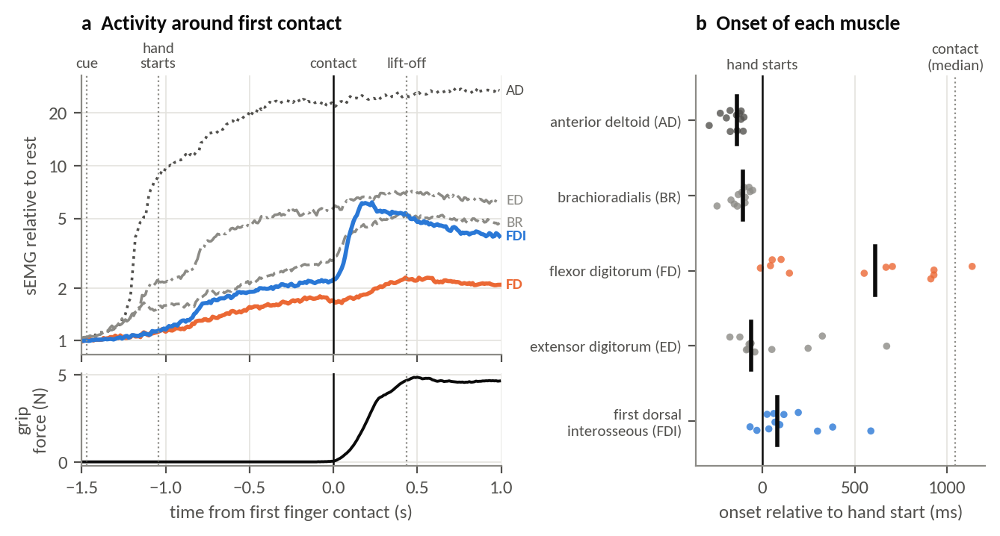

# Figure 13: When the muscles switch on, WAY-EEG-GAL

In WAY-EEG-GAL the pinch is part of a whole movement. After an LED cue the person reaches for an object, grips it between thumb and index finger, lifts it, holds it, puts it back and returns the hand to rest (12 people, 3,528 trials). sEMG comes from five muscles. In each trial, each muscle's causal 20 ms RMS is compared with its level with the hand at rest just before the cue, and the onset is the first time after the cue that it stays above 3 SD for 25 ms. Event times (hand start, first contact, lift-off) are the authors'.

(a) sEMG relative to rest, aligned to first finger contact (median over trials, then across people), with grip force below.
(b) Onset of each muscle relative to the start of the hand movement; each point is one person's median.

Median across people (IQR):

| Muscle | Onset vs. hand start | Onset vs. first contact | People with onset after hand start |
|---|---|---|---|
| anterior deltoid | −138 ms (−179 to −115) | −1206 ms | 0 of 12 |
| brachioradialis | −104 ms (−139 to −87) | −1164 ms | 0 of 12 |
| extensor digitorum | −62 ms (−80 to 101) | −1117 ms | 4 of 12 |
| first dorsal interosseous | 82 ms (33 to 221) | −820 ms | 10 of 12 |
| flexor digitorum | 610 ms (90 to 916) | −474 ms | 11 of 12 |

The hand started moving about 1 s before first contact (median 1044 ms), and lift-off came 437 ms after contact.

The shoulder and forearm muscles switched on just before the hand moved. The first dorsal interosseous switched on shortly after, about 820 ms before contact, and rose slowly during the reach to about twice its rest level at contact (panel a). Its main burst came after contact: it was half-way to its peak 105 ms after contact, against 225 ms for grip force, and came first in 11 of 12 people. The flexor digitorum was the least clear. An onset was found in only 75% of trials, and it ranged from the start of the reach to near contact between people.

So in this task, finger-muscle activity before contact is mostly the reach and the shaping of the hand, not the pinch itself. The 20 ms trailing window delays the envelope by up to 20 ms.
