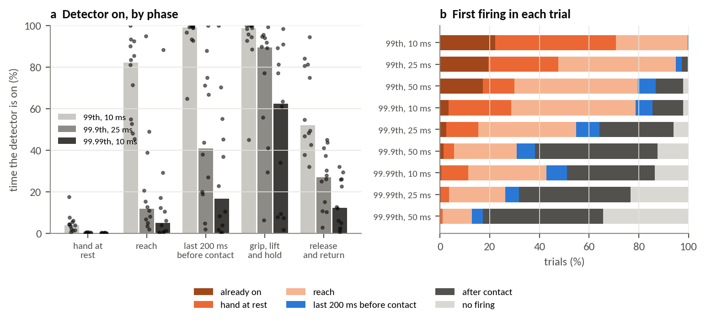

# Figure 14: The detector during a reach, WAY-EEG-GAL

The detector of [Figure 10](Figure10.md) on the two finger muscles recorded, the flexor digitorum and the first dorsal interosseous. Each muscle's causal 20 ms RMS is z-scored against its level with the hand at rest in series 1, and the detector output is the mean of the two. Thresholds are percentiles (99, 99.9, 99.99) of that output at rest in series 1. Once fired, the detector stays on until the output has been below threshold for 200 ms. Test: series 2 to 9, 12 people. Time tested, all people together: 257 min at rest, 41 min reaching, 10.5 min in the last 200 ms before contact, 194 min gripping, lifting and holding, 67 min releasing and returning.

(a) Share of time the detector was on in each phase, for three settings: median across people (bars) and each person (points).
(b) Where the first firing of each trial fell, for all nine settings (mean of the people's shares).

| Setting | On during reach | On, last 200 ms | On during grip | False alarms per min at rest | First firing before the reach | during the reach | in the last 200 ms | after contact | none |
|---|---|---|---|---|---|---|---|---|---|
| 99th, 10 ms | 82% | 99% | 99% | 14.0 | 71% | 29% | 0.2% | 0.1% | 0% |
| 99.9th, 25 ms | 12% | 41% | 90% | 1.2 | 15% | 39% | 9% | 30% | 6% |
| 99.99th, 10 ms | 5% | 17% | 62% | 1.2 | 11% | 32% | 8% | 35% | 14% |

"Before the reach" includes trials where the detector was still on from the previous one.

At the most sensitive setting the detector was on for most of the reach and fired at rest 14 times a minute. At the stricter settings it was quiet for most of the reach, but the first firing still came during the reach in about a third of trials, and after contact in another third. At no setting did more than 9% of trials first fire in the last 200 ms before contact, which is where a pinch warning would be useful.

People differed a lot (points in panel a). False alarms at rest ranged from 0.2 to 9 per minute at the 99.9th percentile and 25 ms.

With these two muscles, a threshold could not tell the approach to a pinch from the reach: settings sensitive enough to fire before contact also fired during the reach and at rest, and settings that stayed quiet fired after contact or not at all. This matches [Figure 13](Figure13.md), where the first dorsal interosseous switches on early in the reach. A detector trained on reaches and grips, or more electrodes, may do better.
