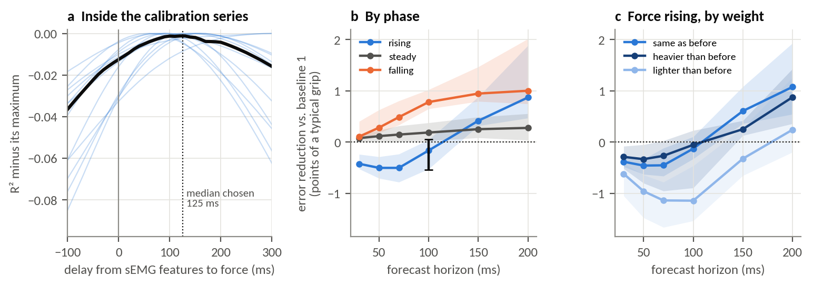

# Figure 15: Grip force forecast, WAY-EEG-GAL

The analyses of [Figures 9](Figure9.md) and [11](Figure11.md) on grip force (mean normal force on the index and thumb plates), with the five muscles as input. Each of the nine series of a person is tested with a model calibrated on the other eight. Errors are in points of a typical grip (95th percentile of grip force). Force is taken 2 ms before each feature time, so at 0 ms the force never comes after the last sEMG sample the features use.

**Grip force target.** In some series the plates also record the experimenter handling the object between trials. So I set grip force to zero outside each grip, from 0.1 s before first contact to 0.2 s after release, using the authors' event times. This makes the time between grips easy to predict. R² of the force estimate was 0.65 over whole series but 0.39 over the grips alone (medians). Changing the margins to 0.05/0.1 s or 0.2/0.4 s gave grip-only R² of 0.36 and 0.42; whole-series R² stayed at 0.65. The zeroed stretches are labelled as rest and left out of the gains below, which are scored only while force rises, holds or falls.

**Delay.** Chosen inside the eight calibration series, leaving one series out at a time. Median 125 ms (IQR 90 to 160 ms, 108 folds). On the held-out series it raised R² from 0.65 to 0.66, higher in all 12 people but by at most 0.03.

(a) Cross-validated R² inside the calibration series for each delay, relative to its maximum. (b) Gain against baseline 1 (own estimate) while grip force rises, holds or falls: median across people, band from the 25th to the 75th percentile. (c) The same while grip force rises, by the object's weight relative to the previous trial.

**Primary comparison** (force rising, 100 ms ahead): median gain −0.16 points, 95% CI −0.54 to 0.05, Wilcoxon p = 0.13. Positive in 4 of 12 people. No gain at 100 ms.

Exploratory, median gain and in brackets the people whose own interval was above / below zero:

| Phase | 30 ms | 50 ms | 70 ms | 100 ms | 150 ms | 200 ms |
|---|---|---|---|---|---|---|
| Rising | −0.42 (1/10) | −0.51 (1/10) | −0.51 (1/10) | −0.16 (1/5) | 0.41 (9/0) | 0.87 (11/0) |
| Steady | 0.07 (8/1) | 0.12 (8/1) | 0.14 (8/1) | 0.18 (9/2) | 0.25 (9/2) | 0.28 (7/3) |
| Falling | 0.11 (7/1) | 0.28 (10/0) | 0.48 (12/0) | 0.78 (12/0) | 0.94 (12/0) | 1.00 (12/0) |
| Rising, same weight | −0.39 (1/10) | −0.46 (1/10) | −0.45 (1/9) | −0.13 (2/3) | 0.60 (10/0) | 1.07 (12/0) |
| Rising, heavier | −0.29 (1/7) | −0.33 (1/6) | −0.27 (1/5) | −0.05 (1/2) | 0.25 (2/0) | 0.88 (6/0) |
| Rising, lighter | −0.62 (0/11) | −0.96 (0/11) | −1.14 (0/11) | −1.15 (0/10) | −0.33 (3/2) | 0.24 (4/2) |

While grip force rose, the forecast was worse than its own estimate up to 70 ms, about even at 100 ms, and better at 150 and 200 ms (0.4 and 0.9 points). During release the gain grew with the horizon, to 1.0 point at 200 ms, clear in all 12 people from 70 ms.

A heavier object than in the previous trial did not change the gain much (−0.38 to +0.06 points against the same weight). A lighter one lowered it at every horizon, by up to 1.0 point at 100 ms, and in all 12 people up to 100 ms. An unexpected weight change did not make the forecast more useful.

Repeating the measured force (baseline 2, needs a force sensor) was better up to 70 ms in every phase and at every horizon during holds. While force rose, the forecast was better from 150 ms.

The weight cases rest on about 7 s of rising grip force per person and case. All series of a person come from one session, so this dataset does not test a new session.
