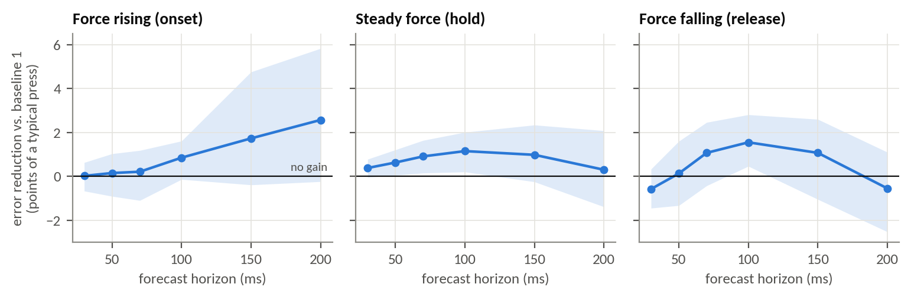

# Figure 2: Forecast against baselines, one person

Middle finger force predicted 30 to 200 ms ahead, calibrating on one trial and testing on the other, in both directions (Hyser subject 1). Errors are split by what the measured force was doing: rising, steady or falling.

The forecast is a ridge regression on causal sEMG features (now, 30 and 60 ms ago). It is compared with four baselines:

1. its own current force estimate, repeated: what a system without a force sensor can use;
2. the last measured force, repeated: an offline reference, it needs a sensor;
3. a trend of its own estimate, with the damping chosen on the calibration trial;
4. a reduced physiological model with calibrated activation dynamics.

The figure shows the gain against baseline 1: its error minus the forecast's error, in points of a typical press (positive means the forecast helps). Brackets: 95% interval from a moving-block bootstrap of the test samples (1 s blocks, same resample for every model).

| Horizon | Rising | Steady | Falling |
|---|---|---|---|
| 30 ms | 0.0 [−0.7, 0.6] | 0.4 [−0.0, 0.8] | −0.6 [−1.4, 0.3] |
| 50 ms | 0.1 [−0.9, 1.0] | 0.6 [0.1, 1.2] | 0.1 [−1.3, 1.6] |
| 70 ms | 0.2 [−1.1, 1.2] | 0.9 [0.2, 1.6] | 1.1 [−0.4, 2.5] |
| 100 ms | 0.8 [−0.1, 1.6] | 1.1 [0.2, 2.0] | 1.6 [0.5, 2.8] |
| 150 ms | 1.7 [−0.4, 4.8] | 1.0 [−0.2, 2.3] | 1.1 [−1.1, 2.6] |
| 200 ms | 2.6 [−0.2, 5.8] | 0.3 [−1.4, 2.1] | −0.6 [−2.5, 1.1] |

The gain was small, at most 2.6 points. While force rose, the case that matters for anticipation, the interval included zero at every horizon. The gains clearly above zero were during holds (50 to 100 ms) and release (100 ms).

Repeating the measured force (baseline 2) beat the forecast at 30 ms in every phase and up to 150 ms during holds. It lost from 100 ms ahead while force rose or fell, by 9 and 11 points at 100 ms. The physiological model (baseline 4) was worse than the forecast at 150 and 200 ms during holds and from 100 ms during release, and similar elsewhere. For the trend (baseline 3), the calibration trial chose no damping at all, so it gave the same predictions as baseline 1.

The intervals describe variation over time within two recordings of one person, not between people. Figure 7 does this across 19 people.
