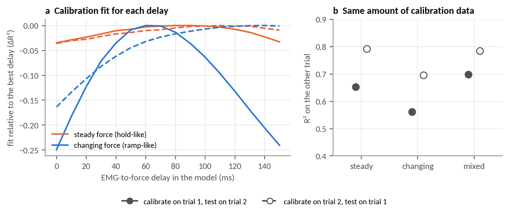

# Figure 3: What kind of calibration data

Using the middle finger recordings of one Hyser participant, I compared three selections of labelled samples from the calibration trial: steady force (including rest), changing force (rising and falling), and a random mix. Each selection had the same number of samples (577 or 210, depending on the trial). The unlabelled sEMG of the whole trial was used for normalisation. Models were fitted on one trial and tested on the other, in both directions.

(a) I fitted the reduced physiological model at every sEMG-to-force delay from 0 to 150 ms and looked at how much the fit changed across delays. With steady force it hardly changed (0.035 and 0.036 in R²), so the data said little about the delay. With changing force it changed much more (0.25 and 0.16), and the mix was in between (0.10 and 0.11). A fit that is sensitive to the delay does not mean the true delay was found, only that the data could tell delays apart.

(b) For the forecast 50 ms ahead, steady force samples gave R² of 0.65 and 0.79 on the other trial, changing force samples 0.56 and 0.70, and the mix 0.70 and 0.78.

So which samples go into a calibration changes both what the model can learn about timing and how well it predicts, and they don't point the same way. The big limitation is that the samples were picked afterwards from one person's recordings. Figure 9 shows the same flat delay profile in putEMG-Force, where most of the calibration is steady holding.
