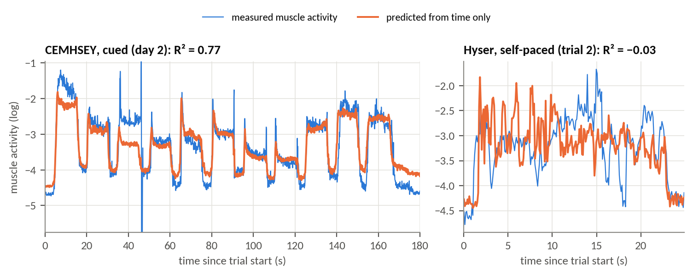

# Figure 4: Cue-only control

This predictor uses only the time since the trial started, not the current sEMG. It checks whether a repeated experimental schedule is enough to predict a signal that seems to anticipate a movement.

In CEMHSEY the gestures follow a fixed cue protocol. I predicted the muscle activity (mean log RMS over electrodes, 100 ms windows) of a held-out trial from the average time course of four day-1 trials. The level is matched to each predicted trial, so only the time course is compared. On Hyser, which has no cues, trial 1 at the same elapsed time predicts trial 2 and the reverse.

- CEMHSEY (cued): R² 0.77 on the day-2 trial shown, and 0.77 to 0.91 across the six held-out trials.
- Hyser (self-paced): R² −0.03 in the direction shown and −0.18 in the other.

A regular schedule can make activity look predictable without any information from the sEMG. A force forecast tested on cued data should be compared with a cue-only control like this one, and ideally tested on less predictable movements. The multi-person analyses use self-paced presses (Hyser) and presses to a target with irregular rest periods (putEMG-Force), and compare the forecast with the model's own current estimate.

CEMHSEY GESTURE has no measured force, so what is predicted here is muscle activity, not pinch force.
