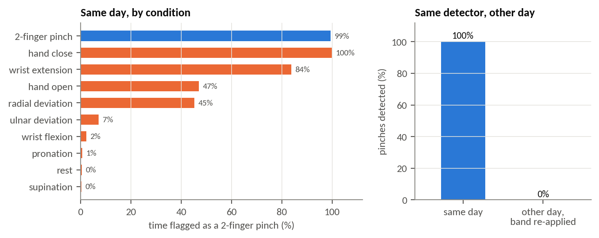

# Figure 5: False pinches and putting the electrodes back on

A 2-finger pinch detector, fitted only on pinch and rest (z-score, 20 principal components, logistic regression, all fitted on the pinch and rest windows of the calibration trials). It never sees the other movements during calibration. Then I tested it on the other movements, and on a different day, after the electrodes had been taken off and put back on. CEMHSEY subject 1, five trials per day.

Left: share of time flagged as pinch in each cued condition (same day, each trial tested with a detector calibrated on the other four).

| Condition | Flagged as pinch |
|---|---|
| 2-finger pinch | 99% |
| rest | 0.5% |
| hand close | 99.8% |
| wrist extension | 84% |
| hand open | 47% |
| radial deviation | 45% |
| ulnar deviation | 7% |
| wrist flexion | 2% |
| pronation, supination | under 1% |

Counting a false pinch as at least three flagged windows in a row (300 ms) inside one labelled period, that is 0.33 false pinches per minute at rest and 11.5 per minute during the other movements.

Right: the same detector found 10 of 10 pinches on its own day, and 0 of 10 on the other day.

A detector can look good on pinch and rest and still fire during ordinary hand and wrist movements, and it can stop working after the electrodes move. False alarms should be measured during movement, not just at rest, and the operating point checked across sessions. Figures 10, 12 and 14 do this with more people.

CEMHSEY GESTURE has cue labels, not measured force, so the percentages are time flagged, not detected force onsets. This is one person and a small number of pinches.
