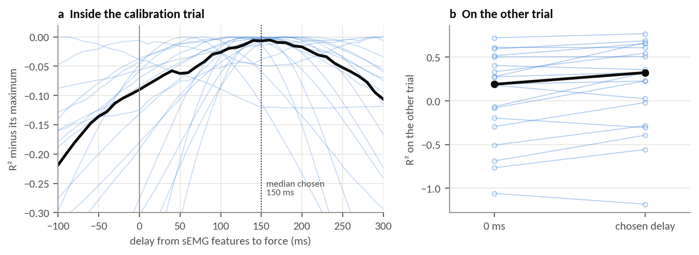

# Figure 6: How far ahead the sEMG predicts force, Hyser

For each person, ridge models from the causal sEMG features at *t* (envelope now, 30 and 60 ms ago) to the middle finger force at *t* + *d*, for *d* from −100 to 300 ms. The delay is chosen inside the calibration trial by blocked cross-validation (five blocks, with a gap between training and validation samples). The model at that delay is then scored once on the other trial, and so is the model at 0 ms. Both directions, 19 people with an active middle finger.

(a) Cross-validated R² inside the calibration trial for each delay, relative to its maximum. Thin lines are people, black is the median.
(b) R² on the other trial at 0 ms and at the chosen delay.

- The chosen delay had a median of 150 ms (IQR 98 to 210 ms) over the 38 calibration trials. Three were at or below 0 ms and four at the end of the range (300 ms). The pilot person was at 50 and 70 ms.
- It was not stable within a person: the two trials of the same person gave delays a median of 90 ms apart (0 to 400 ms).
- On the other trial, R² rose from 0.19 at 0 ms to 0.32 at the chosen delay (medians), and was higher in 14 of 19 people.
- For 6 of the 19 people R² on the other trial stayed below zero even at the chosen delay. One 25 s trial is not always enough to calibrate a model that holds on the next one.

So the sEMG carries most information about force some 100 to 200 ms ahead in this task. This delay mixes the electromechanical delay with the slow rise and fall of force, and it may also include a delay in how the force was filtered before it was stored (up to about 80 ms, see [Figure 1](Figure1.md)). I read it as the time scale a forecast can work with, not as a latency.
