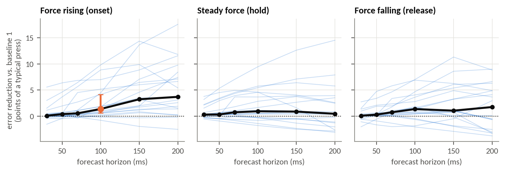

# Figure 7: Forecast against its own estimate, Hyser

The analysis of [Figure 2](Figure2.md) for every person: middle finger force predicted 30 to 200 ms ahead, calibrating on one trial and testing on the other, in both directions. Each thin line is one person (19 with an active middle finger), black is the median. Positive values mean the sEMG forecast had a lower error than baseline 1, which repeats the model's own current estimate.

**Primary comparison** (force rising, 100 ms ahead): median gain 1.37 points of a typical press, 95% CI 0.59 to 4.16 from resampling people, Wilcoxon p = 0.00058. The gain was positive in 17 of 19 people, but each person's own bootstrap interval was above zero in only 5 of them.

Everything else is exploratory. Median gain, and in brackets the number of people whose own 95% interval was above / below zero:

| Phase | 30 ms | 50 ms | 70 ms | 100 ms | 150 ms | 200 ms |
|---|---|---|---|---|---|---|
| Rising | 0.08 (3/1) | 0.39 (3/0) | 0.54 (3/1) | 1.37 (5/1) | 3.23 (11/1) | 3.69 (10/1) |
| Steady | 0.30 (7/1) | 0.32 (9/2) | 0.74 (10/2) | 0.93 (10/2) | 0.87 (8/2) | 0.45 (5/2) |
| Falling | 0.08 (5/0) | 0.29 (5/1) | 0.74 (4/1) | 1.35 (7/1) | 1.05 (7/1) | 1.74 (6/2) |

While force rose, the gain grew with the horizon: close to zero up to 70 ms, 1.4 points at 100 ms and over 3 points at 150 to 200 ms, where about half the people had a clear gain. During holds and release it stayed under 2 points.

Repeating the measured force (baseline 2, needs a force sensor) was still much better at short horizons: by 28.6 points at 30 ms and 12.1 at 100 ms while force rose, and at every horizon during holds and release. Only at 200 ms while force rose was the forecast better (8.3 points).

The pilot person was below the median: 0.9 points at 100 ms while force rose. Intervals within a person come from a moving-block bootstrap (500 resamples, 1 s blocks).
