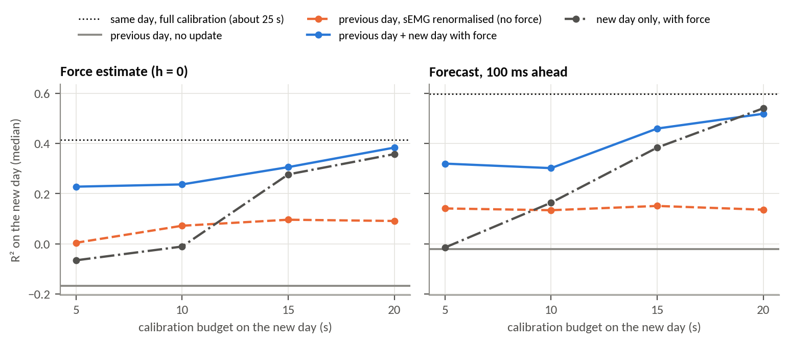

# Figure 8: From one day to the next, Hyser

The two Hyser sessions were recorded on different days, with the electrodes placed again. I tested every calibration on session 2, trial 2 (middle finger, 19 people):

- **same day:** the whole of session 2, trial 1 (about 25 s), with its own electrode check. This is the reference.
- **previous day:** session 1, trial 1, as it is.
- **previous day, renormalised:** the same model with the sEMG normalisation updated on the start of session 2, trial 1. This needs no force.
- **both days:** session 1 plus the start of session 2, trial 1, with force.
- **new day only:** the start of session 2, trial 1, with force.

Apart from the reference, every calibration keeps the electrodes chosen on day 1, as a device that cannot re-check them would. A budget of 10 s counts everything from the start of the new recording to the last sample used, including the first second (not fitted) and the forecast horizon.

Median R² on the new day:

| Calibration | Force estimate | Forecast, 100 ms ahead |
|---|---|---|
| Same day | 0.41 | 0.60 |
| Previous day | −0.17 | −0.02 |
| Previous day, renormalised on 10 s / 20 s | 0.07 / 0.09 | 0.13 / 0.14 |
| Both days, 10 s / 20 s of the new day | 0.24 / 0.38 | 0.30 / 0.52 |
| New day only, 10 s / 20 s | −0.01 / 0.36 | 0.16 / 0.54 |

A day-1 model did not work on day 2, and updating only the normalisation helped little. Data with force from the new day brought most of the performance back. With 5 or 10 s it was better to keep the day-1 data (R² 0.23 and 0.24, against −0.07 and −0.01 for the new day alone); by 20 s the two were about the same.

For a device this points to a short calibration with force at the start of each session that adds to the earlier ones. Each recording is 25 s, so I could not test longer budgets.
