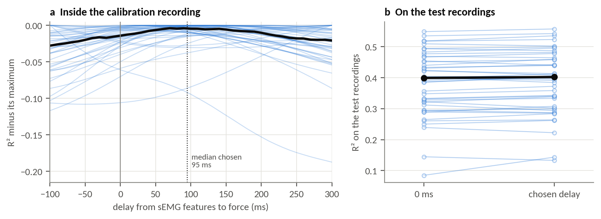

# Figure 9: How far ahead the sEMG predicts force, putEMG-Force

The analysis of [Figure 6](Figure6.md) on a second dataset. For each finger, ridge models from the causal sEMG features at *t* to force at *t* + *d* (*d* from −100 to 300 ms). The delay is chosen inside the calibration recording (`repeats_long`) by blocked cross-validation, as the maximum of the profile averaged over the four finger forces, so there is one delay per session. The models at that delay are then scored once on `sequential` and `repeats_short`. Each session is analysed on its own and the two are averaged. 44 people.

(a) Cross-validated R² inside the calibration recording for each delay, relative to its maximum (mean over fingers and sessions). Black is the median.
(b) R² on the test recordings at 0 ms and at the chosen delay.

- The median profile in (a) is almost flat: it moves by less than 0.03 in R² from −100 to 300 ms.
- So the chosen delay spread widely: median 95 ms, IQR 20 to 190 ms over 88 sessions, with 20 at or below 0 ms and 12 at 300 ms. The two sessions of a person gave delays a median of 80 ms apart.
- On the test recordings it made almost no difference: R² 0.40 at 0 ms and 0.40 at the chosen delay (medians; per person from −0.02 to +0.06). It was higher in 28 of 44 people.

In Hyser, choosing a delay helped (R² from 0.19 to 0.32). Here it did not. The likely reason is the task: putEMG presses are steps held for 1 or 3 s, so most of the force variance is in the holds, where shifting the force by 100 ms changes little. That is the same thing [Figure 3](Figure3.md) showed for steady calibration data in one person. The tasks and the recording setups both differ between the two datasets, so this comparison cannot separate them.
